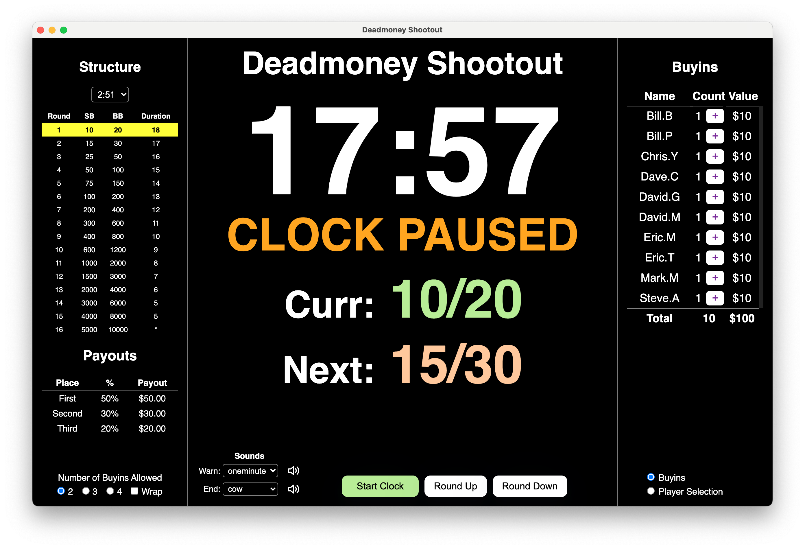

## Poker Timer

A desktop poker timer built with Electron, React, and TypeScript.

## Application screenshot



## AI Assistance Embeded

This repo has markdown files for both CLAUDE Code and Copilot to keep later instances of the AI tool up to date on any new learnings the last instance used in Building, Testing, Running or Deploying this code base.

CLAUDE Code uses CLAUDE.md <br>
Copilot uses copilot-instructions.md

Just ask AI assistant to "**run the app**", or "**commit and push**" or "**build a .dmg file for me**".

## Quick start

This repo needs Node 16 to run correctly. Modern Node versions (including Node 26) can break the webpack/css-loader toolchain and Electron startup flow.

```bash
export NVM_DIR="$HOME/.nvm"
. "$NVM_DIR/nvm.sh"
nvm use 16
npm install -g yarn
cd /Users/ericthornton/repos/poker_timer
yarn install --frozen-lockfile --non-interactive
yarn cross-env NODE_ENV=development webpack --config ./.erb/configs/webpack.config.renderer.dev.dll.babel.js
mkdir -p /tmp/noop-npm
printf '%s\n' '#!/bin/sh' 'sleep 100000' > /tmp/noop-npm/npm
chmod +x /tmp/noop-npm/npm
PATH="/tmp/noop-npm:$PATH" yarn start:renderer
```

Then start Electron in a second terminal:

```bash
export NVM_DIR="$HOME/.nvm"
. "$NVM_DIR/nvm.sh"
nvm use 16
cd /Users/ericthornton/repos/poker_timer
env -u ELECTRON_RUN_AS_NODE yarn start:main
```

## Why this is different from the stock boilerplate

- The repo’s development startup requires the renderer DLL to be built before the app can serve assets.
- `ELECTRON_RUN_AS_NODE=1` must be unset when launching Electron in VS Code or other tool environments.
- The `no-op npm shim` is used so the older renderer spawn flow does not kill the dev server.
- This app is intended to run locally with Node 16 only.

## Package / production build

```bash
yarn package
```

## License

MIT
